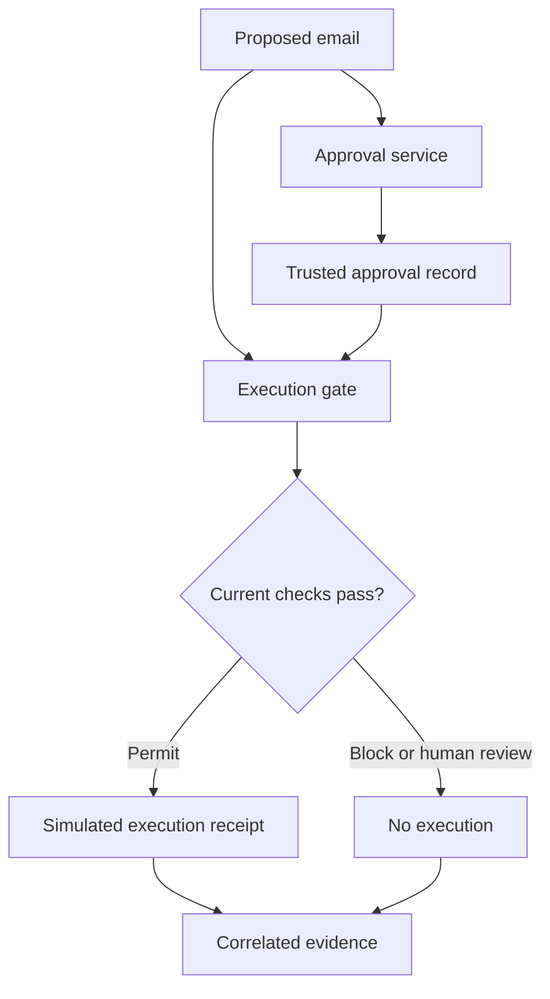

# AI Governance Email Gate

**Grace Adjeli | BridgeCore AI**

A working, synthetic demonstrator of approval binding, execution-time authorization checks, and a bounded failure-to-restoration exercise. Built as the technical foundation for Episode 6, **Engineering AI Governance**.

## Problem statement

An AI assistant drafts an email for a human to review. The human approves one recipient, one message, one set of attachments, and one sending identity. Before execution, the assistant changes the recipient or attachment—or the conditions supporting approval change.

If the sending service only checks that an approval exists, it can execute an action the reviewer never authorized. A documented policy and an approval checkbox do not establish that the final action remains within the approved boundary.

The engineering problem is to bind approval to a specific action, revalidate its conditions immediately before execution, prevent changed or unauthorized actions from proceeding, and record evidence linking authorization to the observed outcome. If a control fails, a subsequent successful run alone does not establish that the affected assurance claim can be restored.

## Project objectives

1. Bind a trusted approval record to the exact email payload and policy configuration.
2. Independently enforce current authority, expiration, recipient permissions, data rules, and one-time execution.
3. Route changed payloads or conditions to fresh review without executing them.
4. Correlate approval, decision, and simulated execution evidence.
5. Demonstrate invalidation, correction, same-condition retest, regression, and simulated designated-reviewer restoration for a bounded control claim.

## Scope

Python 3.10+; standard library only. The assistant is represented by an email object. All addresses use `example.test`; no network transport, credentials, live model, or paid API is required.

This is a single-process educational implementation. Human identity, time, attachment hashes, data classification, and restoration review are trusted synthetic inputs. It does not establish enterprise assurance or real email delivery. See [limitations](docs/design.md#material-limitations).

## Quick start

Clone the private repository using your authorized GitHub account, then run from its root:

```bash
git clone https://github.com/BridgeCoreAI/ai-governance-email-gate.git
cd ai-governance-email-gate
python -m unittest discover -s tests -v
python -m email_gate.demo
```

On Windows, use `py` if `python` is unavailable. No dependency installation is required. The demo prints JSON evidence; test results appear on stderr. UUIDs vary between runs.

To capture a new evidence run:

```bash
python -m email_gate.demo > evidence-run.json
```

Do not mistake generated evidence for independently verified assurance.

## Architecture



The approval service records sender, To/CC/BCC, subject, body, attachment filename/content hashes, approver, expiration, and the complete policy fingerprint. The gate looks up that record by ID; the proposed action cannot supply its own approval claims.

Only PERMIT produces a simulated receipt. BLOCK and HUMAN_REVIEW both prevent execution. Human review requires an explicit new approval and another gate evaluation; it does not silently become permission.

## Scenarios

| Scenario | Expected behavior |
|---|---|
| Approved payload with current permissions | PERMIT; simulated receipt |
| Missing or revoked approval | BLOCK; no receipt |
| Recipient, message, attachment hash, or sender changed | HUMAN_REVIEW; no receipt |
| Policy content changed, even without a version label change | HUMAN_REVIEW; no receipt |
| Approval expired | HUMAN_REVIEW; no receipt |
| Recipient outside current permissions or non-synthetic classification | BLOCK; no receipt |
| Approval reused | BLOCK; no second receipt |
| Fresh approval for revised permitted payload | PERMIT; simulated receipt |

## Failure and recovery example

The demo includes an isolated deliberately defective fixture that checks approval presence but omits payload binding. It permits an altered recipient. The exercise records that failure and invalidates the affected claim, binds the corrected gate to its source hash, retests the same condition, runs regressions, and requires a simulated designated reviewer before restoring the bounded claim.

This represents a known omitted check, not a historical production incident or deployed patch. Restoring the control claim does not authorize the next email.

## Repository guide

| File | Purpose |
|---|---|
| `email_gate/core.py` | Payload, policy, trusted approval records, gate, simulated receipts |
| `email_gate/recovery.py` | Bounded assurance-state transitions |
| `email_gate/demo.py` | Executable synthetic failure, retest, review, and evidence example |
| `tests/test_gate.py` | Authorization and negative-path tests |
| `tests/test_recovery.py` | Restoration prerequisites and evidence-binding tests |
| [Design](docs/design.md) | Architecture decisions, trust boundaries, limitations |
| [Requirements](docs/requirements.md) | Control requirements and acceptance criteria |
| [Evidence guide](docs/evidence-guide.md) | Reproduction, fields, interpretation, and claim limits |
| [Sample evidence](docs/sample-evidence.json) | Recorded local demo output |
| [Release checklist](docs/release-checklist.md) | Criteria before public publication |
| [Contributing](CONTRIBUTING.md) | Development and review expectations |
| [Security](SECURITY.md) | Reporting guidance and supported scope |
| `.github/workflows/tests.yml` | Automated tests on pushes and pull requests |

## Validation status

18 unit tests passed locally on Python 3.12, including seven payload-change subcases.

GitHub Actions has also executed the repository workflow on `main` for Python 3.10 and Python 3.12. Both matrix jobs completed successfully, including:

- the full control and recovery test suite
- the synthetic evidence demonstration
- generation of a run-specific evidence manifest
- upload of downloadable evidence artifacts for each Python version

The CI evidence manifest records the tested commit, workflow run and attempt, Python version, and SHA256 digest of the generated evidence file. These results strengthen reproducibility of the demonstrator, but they are still automated repository evidence—not independent certification, production assurance, or proof of real email delivery.

See [Evidence guide](docs/evidence-guide.md) for how to retrieve and interpret fresh CI evidence.

## License and attribution

Apache License 2.0; see [LICENSE](LICENSE). The software license does not grant permission to use BridgeCore AI branding. Author: **Grace Adjeli**, BridgeCore AI.

**Governance is not what is defined. It is what is enforced at execution.**

Grace Adjeli
