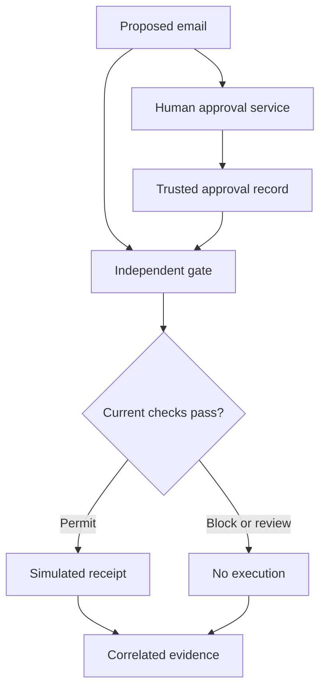

# Requirements, trust boundaries and evidence

## DL-001 — Bounded implementation

Use deterministic synthetic emails and a simulated transport. Keep the repository private during development. Publish only after release review. No enterprise assurance claim.

## DL-002 — Trusted approval records

An approval ID references an in-memory trusted record; the proposed action cannot supply its own approval attributes. SHA256 fingerprints bind exact payload and policy content. A fingerprint is a change detector, not authentication or a digital signature. Attachment entries contain hashes of bytes; a real adapter must compute those hashes from the actual attachments, rather than trust agent-supplied hashes.

## Requirements and validation

| Control | Requirement | Test evidence |
|---|---|---|
| CTRL-01 | Require authorized approver and existing approval | missing approval, untrusted approver |
| CTRL-02 | Exact payload binding including recipient fields and attachment content hashes | changed-fields subtests; fresh approval |
| CTRL-03 | Revalidate authority, expiry and configuration at execution | revocation, removed approver, expiry, configuration without version bump |
| CTRL-04 | Enforce recipient and data permissions independently | recipient permission, data rule |
| CTRL-05 | Prevent repeated execution using one approval | replay |
| CTRL-06 | Correlate approved and simulated executed payload | approved receipt fingerprint |
| CTRL-07 | Require matching-condition/version retest and simulated review for restoration | recovery tests and demo |

## Runtime flow

## Failure and restoration

The demo's deliberately defective fixture omits payload binding and returns PERMIT for an altered recipient. Record the original and altered payload fingerprints, policy, expected and actual result, affected fixture hash, and invalidated control claim. Bind correction to the exact `core.py` source hash. Retest the same recipient-change condition against the gate, run regression tests, and record test-source hash and result. The simulated review requires matching correction/deployed hash; mismatched evidence or reviewer blocks restoration. A new failure invalidates the state again.

The label RESTORED_BOUNDED applies only to the recorded synthetic control condition. It is not evidence that all controls, impacts, or outcomes are assured. A permit still requires a separate execution-time check.

## Material limitations

- Trusted caller supplies approver identity, time, data classification and attachment hashes. These are simulated boundaries, not authenticated external inputs.
- Python frozen objects and synchronous execution support this exercise. No concurrency, durable transaction, retry/crash recovery, independent process isolation or tamper-resistant storage is implemented.
- Events and receipts are in-memory records, not immutable or independently verified logs. No audit signing, durable retention or privacy-sensitive evidence handling.
- The transport records a receipt; it does not deliver email. Production integration must atomically validate and dispatch the exact bytes, prevent bypass, and handle delivery failures and uncertain outcomes.
- Recovery reports are trusted test-runner inputs. Reviewer identity and deployed-version comparison are simulated. A production release authority requires authenticated roles and independent evidence review.
- Correct authorization does not prove factual accuracy, reviewer competence, adequate context, or acceptable stakeholder outcomes.
- No live model, tool credential, external data ingestion, legal compliance certification, or generalized AI risk controls.

## Release review

Before making public: inspect synthetic fixtures and evidence for secrets/personal data, rerun tests on the final commit, verify documentation scope, review branding and license, and obtain Grace's public-release decision.
